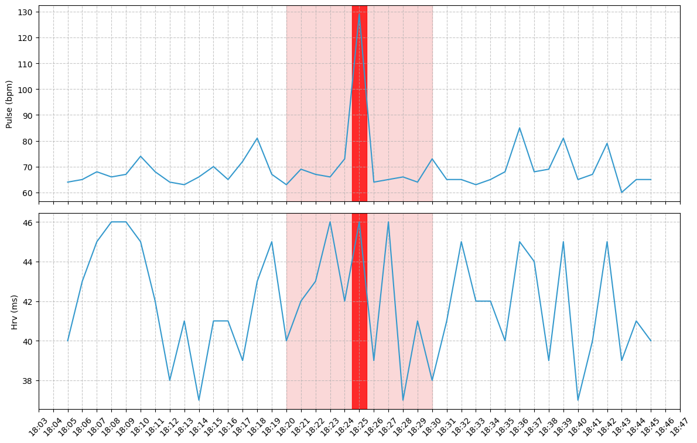

# AI on The Pulse

This repository contains code from the "AI on The Pulse" paper.

## Anomaly Explanation Prompt Structure

To generate a clinically relevant explanation for detected anomalies, the system constructs a specific prompt that is sent to the OpenAI GPT model (specifically `gpt-4o`). This prompt is dynamically built based on the specific anomaly data and the patient's context, providing the AI with all the necessary information and clearly defining the expected output format.

The prompt construction follows a structured approach, progressively adding layers of information:

1.  **Setting the Stage:** The prompt begins by establishing the AI's persona as an expert system designed to analyze physiological and environmental signals from wearable sensors. It clearly states the primary goal: to provide a structured, medically relevant explanation for the observed anomalies.

2.  **Defining the Data:** Crucially, the prompt includes detailed descriptions for *all* the relevant data signals present in the anomaly data. This ensures the AI understands what each number or value represents (e.g., that 'systolic' means systolic blood pressure in mmHg, 'hrv' is Heart Rate Variability, etc.). It also explicitly defines the 'Anomaly Energy' metric, explaining how its value indicates the intensity of the detected issue relative to a set threshold.

3.  **Providing Patient Context:** To enable a more nuanced and clinically informed assessment, relevant patient information, such as demographics and medical history, is included in a dedicated section of the prompt. This background helps the AI interpret the physiological and environmental data within the context of the individual.

4.  **Presenting the Anomaly Data:** The specific data points associated with the detected anomaly are then included. This section presents the values for each relevant signal at the time of the anomaly in a clear, structured format that the AI can easily process.

5.  **Instructing the Output Structure:** A critical part of the prompt is the explicit instruction on the desired structure for the AI's response. It clearly outlines the specific sections the explanation must contain, guiding the AI to produce a clinically useful assessment. The required structure includes:
    *   **Analysis**: A description of the key anomalies observed in the data, focusing on significant variations and trends over time. This section is instructed to avoid explicitly mentioning the anomaly energy metric itself, focusing instead on the signal values.
    *   **Causes**: Hypotheses on potential causes for the anomaly, drawing connections between the data, patient context, anomaly characteristics (like suddenness or duration), and environmental factors. It also requests differentiation between possible clinical events and sensor artifacts.
    *   **Criticality**: An assessment of the clinical importance of the anomaly, advising on whether immediate action, monitoring, or no specific action is needed.
    *   **Scores**: Two numerical scores (on a scale of 0-10) to quantify the:
        *   **Significance**: The overall clinical relevance of the anomaly.
        *   **Criticality**: The urgency requiring attention.

By combining these components – the AI's role, detailed data definitions, patient background, specific anomaly values, and precise output formatting instructions – the system constructs a comprehensive prompt. This enables the GPT model to generate a structured, contextually relevant, and clinically focused explanation for the detected anomalies, which is then returned by the API.


## Example: Stress Anomaly - Prompt

```
You are an advanced AI system analyzing physiological and environmental signals from a wearable sensor to detect health anomalies.
Your goal is to provide a structured, clinically relevant explanation for detected anomalies.
Below is a description of the provided signals:

- **Pulse**: The number of heartbeats per minute, representing the patient's heart rate.
- **HRV**: Heart Rate Variability, the variation in time intervals between consecutive heartbeats, expressed in milliseconds (ms), reflecting autonomic nervous system function.
- **Timestamp**: The exact date and time the data was recorded.
- **Anomaly Energy**: Ratio of the detected anomaly energy to the threshold, indicating the intensity of the anomaly. Values < 1 are normal; values >= 1 indicate an anomaly.

### Patient Information:
<personal details, demographics, and medical history of the patient, including any relevant conditions or medications that may affect the analysis, redacted for privacy>

### Patient Data:
pulse | hrv | timestamp           | Anomaly Energy
64    | 40  | 2025-02-24 18:05:00 | 0.029
65    | 43  | 2025-02-24 18:06:00 | 0.018
68    | 45  | 2025-02-24 18:07:00 | 0.034
66    | 46  | 2025-02-24 18:08:00 | 0.054
67    | 46  | 2025-02-24 18:09:00 | 0.044
74    | 45  | 2025-02-24 18:10:00 | 0.033
68    | 42  | 2025-02-24 18:11:00 | 0.001
64    | 38  | 2025-02-24 18:12:00 | 0.071
63    | 41  | 2025-02-24 18:13:00 | 0.028
66    | 37  | 2025-02-24 18:14:00 | 0.082
70    | 41  | 2025-02-24 18:15:00 | 0.002
65    | 41  | 2025-02-24 18:16:00 | 0.014
72    | 39  | 2025-02-24 18:17:00 | 0.018
81    | 43  | 2025-02-24 18:18:00 | 0.075
67    | 45  | 2025-02-24 18:19:00 | 0.053
63    | 40  | 2025-02-24 18:20:00 | 0.033
69    | 42  | 2025-02-24 18:21:00 | 0.003
67    | 43  | 2025-02-24 18:22:00 | 0.016
66    | 46  | 2025-02-24 18:23:00 | 0.065
73    | 42  | 2025-02-24 18:24:00 | 0.003
129   | 46  | 2025-02-24 18:25:00 | 1.871
64    | 39  | 2025-02-24 18:26:00 | 0.100
65    | 46  | 2025-02-24 18:27:00 | 0.082
66    | 37  | 2025-02-24 18:28:00 | 0.105
64    | 41  | 2025-02-24 18:29:00 | 0.060
73    | 38  | 2025-02-24 18:30:00 | 0.042
65    | 41  | 2025-02-24 18:31:00 | 0.047
65    | 45  | 2025-02-24 18:32:00 | 0.077
63    | 42  | 2025-02-24 18:33:00 | 0.068
65    | 42  | 2025-02-24 18:34:00 | 0.009
68    | 40  | 2025-02-24 18:35:00 | 0.005
85    | 45  | 2025-02-24 18:36:00 | 0.154
68    | 44  | 2025-02-24 18:37:00 | 0.019
69    | 39  | 2025-02-24 18:38:00 | 0.021
81    | 45  | 2025-02-24 18:39:00 | 0.086
65    | 37  | 2025-02-24 18:40:00 | 0.089
67    | 40  | 2025-02-24 18:41:00 | 0.018
79    | 45  | 2025-02-24 18:42:00 | 0.058
60    | 39  | 2025-02-24 18:43:00 | 0.109
65    | 41  | 2025-02-24 18:44:00 | 0.030
65    | 40  | 2025-02-24 18:45:00 | 0.023

### Provide a concise medical assessment with the following structure:
- **Analysis**: Identify and describe key anomalies, focusing on significant variations in signals. Avoid explicitly mentioning the anomaly energy.
Explain the observed trends over time, highlighting potential health implications.
Use a bullet list format for clarity.

- **Causes**: Hypothesize potential causes based on the patient's demographic data, anomaly characteristics (e.g., sudden, prolonged), and environmental influences. Differentiate between likely clinical events and possible sensor artifacts.

- **Criticality**: Assess the clinical importance of the detected anomalies. Specify if immediate action is needed, if monitoring is advised, or if the anomaly is likely insignificant.

- **Scores**:
    - **Significance Score (0-10)**: Rate the clinical relevance of the anomaly (0 = noise, 10 = critical issue).

    - **Criticality Score (0-10)**: Rate the urgency of the anomaly (0 = minimal concern, 10 = requires immediate attention).

Ensure the explanation is clear, structured, and clinically useful.
```

## Example: Stress Anomaly - Generated Explanation

The following data sample, collected through the ATHOME system, has been analyzed.


<div style='page-break-after: always;'></div>

### Generated Explanation

#### Analysis:
- **Heart Rate Peak**: At 18:25, a significant peak in pulse rate is recorded at 129 bpm, which represents a marked deviation from the patient's baseline range (60-85 bpm). This sudden increase may indicate an acute physiological response.
- **HRV Stability**: During the data analysis, HRV remains relatively stable, with slight fluctuations between 37-46 ms. This suggests that the autonomic nervous system is not experiencing significant stress, despite the anomaly in heart rate.
- **Pulse Variability**: There are occasional increases in pulse (for example, 81 bpm at 18:18 and 18:39, 85 bpm at 18:36), but these are less pronounced compared to the peak at 18:25 and may reflect normal physiological variations or minor stressors.

#### Causes:
- **Clinical Events**: The peak in heart rate may be due to an acute stressor, such as physical exertion, emotional stress, or a reaction to medications. Considering the patient's history of hypertension and peripheral artery disease, cardiovascular events such as arrhythmias or transient ischemic episodes should be considered.
- **Medication Effects**: The patient is on multiple medications that can influence heart rate and blood pressure. Inderal (a beta-blocker) typically reduces heart rate, but interactions or timing of doses could lead to transient peaks.
- **Sensor Artifacts**: Although unlikely given the magnitude of the peak, sensor errors or improper placement could cause inaccurate readings. However, the consistency of other data points suggests this is less probable.

#### Criticality:
- **Immediate Action**: The heart rate peak at 18:25 is clinically significant and requires immediate attention to rule out serious cardiovascular events. Monitoring for any recurring episodes is advised.
- **Monitoring**: Continuous observation of heart rate and HRV is recommended to detect further anomalies or trends that may indicate underlying issues.

#### Scores:
- **Significance Score**: 8 - The heart rate peak is a significant anomaly that may indicate a serious underlying condition.
- **Criticality Score**: 7 - The urgency is high due to the potential for acute cardiovascular events, necessitating timely evaluation.